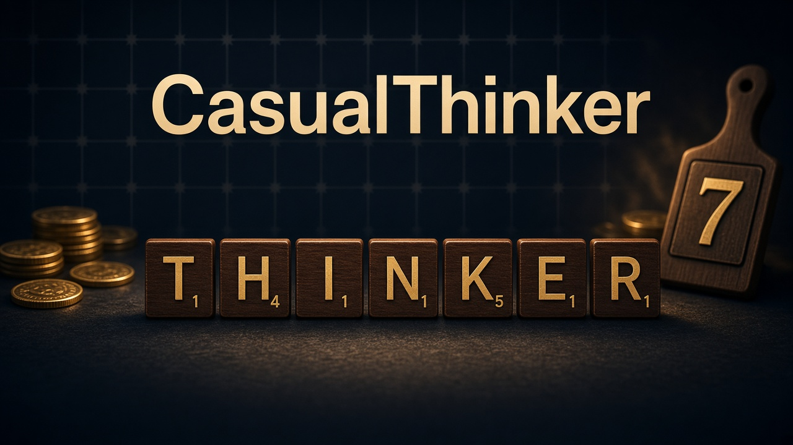
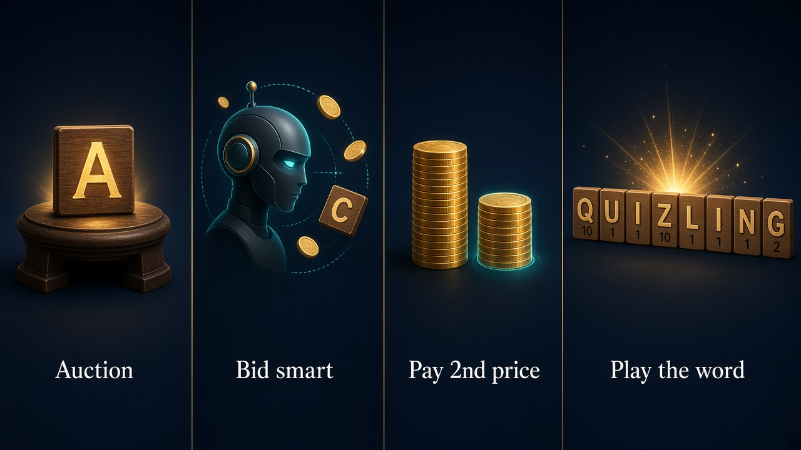
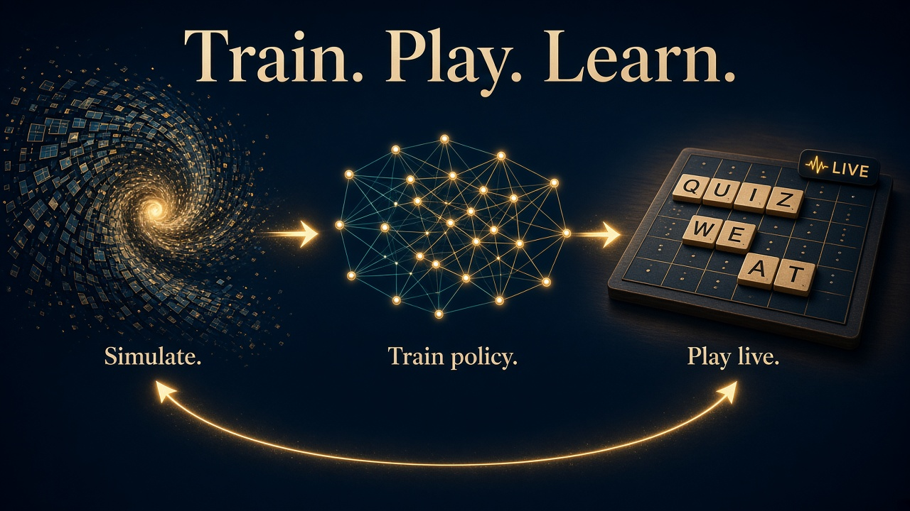
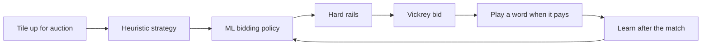

<p align="center">
  
</p>

<h1 align="center">CasualThinker</h1>

<p align="center">
  A casual-lobby <a href="https://scrabblebot.spacetimedb.com/">ScrabbleBot</a> that treats every letter like an auction — and every leftover coin like a missed word.
</p>

<p align="center">
  
  
  
</p>

CasualThinker joins public Vickrey matches on [SpacetimeDB](https://spacetimedb.com/). It never registers for a tournament. It starts with 100 coins, bids for letters against five other bots, then cashes those letters into words. Unspent coins are worth nothing at the end, so the bot is built to spend with a plan — not to sit on a pile of gold.

## How a match works

<p align="center">
  
</p>

Each turn, one tile goes up for auction. Everyone can bid. The highest bidder wins the letter, but pays the **second-highest bid** (a Vickrey auction). Tiles that nobody wants are gone for good — they do not go back in the bag.

A typical casual match looks like this:

- 6 players
- 100 coins and a 5-tile rack to start
- a 98-tile bag with no blanks
- about 68 auctions
- word payouts that grow with length: 2–3 letters pay 1×, 4 pay 1.5×, 5 pay 2×, 6 pay 2.5×, and 7+ pay 3×

So the winning idea is simple: buy the letters that unlock a long word, play that word as soon as it is worth cashing, and do not overpay for a lonely Q, Z, J, or X that cannot actually be used.

## Train. Play. Learn.

<p align="center">
  
</p>

CasualThinker is not a single trick. Three layers work together, and the LLM coach stays **off** the live bid path so a slow model call never misses an auction.



- **Heuristic strategy** — Quackle-inspired leave evaluation, play-out ranking, and phase-aware bidding (midgame, pre-endgame, endgame).
- **ML policy** — a small neural net trained on thousands of simulated matches, saved in `sim/ml-policy.json`.
- **Hard rails** — live-game lessons that stop the net from doing something obviously bad, like bidding on a dead power tile or dumping a long word too late.
- **Online learning** — after each finished match, the bot can update from the real result (place, score, leftover coins).
- **LLM coach** — reads simulator traces and writes a coaching packet. It never decides the live bid.

## Simulated results

These numbers are from the latest held-out evaluation against a **fitted** (hard) field. They are practice games, **not** live win rate.

| Field | Games | Heuristic wins | CasualThinker ML wins | ML average place | ML leftover coins |
| --- | ---: | ---: | ---: | ---: | ---: |
| Fitted / hard | 3,000 | 11.7% | **38.2%** | 2.25 | 12.8 |
| Easy practice | 10,000 | 87.9% | **95.5%** | 1.05 | 8.7 |

The easy field is a much softer opponent mix. Use the hard column if you want the honest simulator read.

## Run

```bash
npm install
BOT_NAME=CasualThinker BOT_TOKEN=<token> npm start
```

The token is saved to `.token-CasualThinker` (gitignored). Later runs only need:

```bash
BOT_NAME=CasualThinker npm start
```

Do not set `TOURNAMENT_ID`. CasualThinker will refuse to register for a tournament.

## Train

```bash
npm run ml-train
```

Useful extras:

```bash
npm test          # strategy, simulator, and ML tests
npm run sim       # run the match simulator
npm run coach     # write an LLM coach packet from traces
npm run ml-eval   # evaluate a saved policy
```

## Project layout

```text
src/            Live bot, strategy, Quackle-inspired eval, ML policy, online learning
src/sim/        High-speed match simulator, trainer, coach, and fitted opponents
sim/            Saved policies, training log, and coach packets
reviews/        Chess-style notes from earlier live matches
spacetimedb/    Official word list used for search and scoring
docs/images/    README artwork
```

## Safety

Never commit `.token-CasualThinker`, `BOT_TOKEN`, or `BOT_NONCE`. Those stay on the machine that runs the bot.

Built for [HackUTD](https://hackutd.co/) against the public [ScrabbleBot](https://github.com/clockworklabs/scrabblebot) module.
