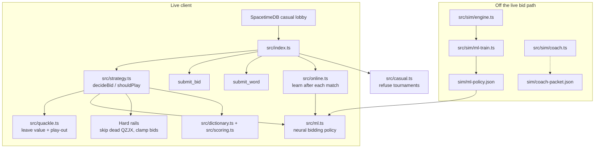
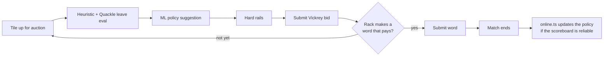
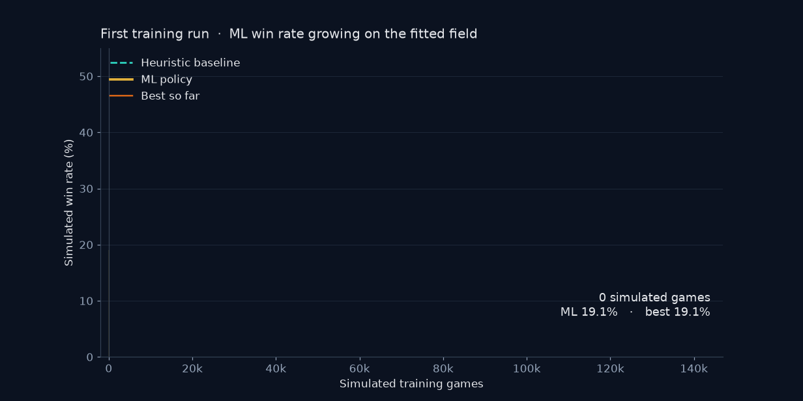
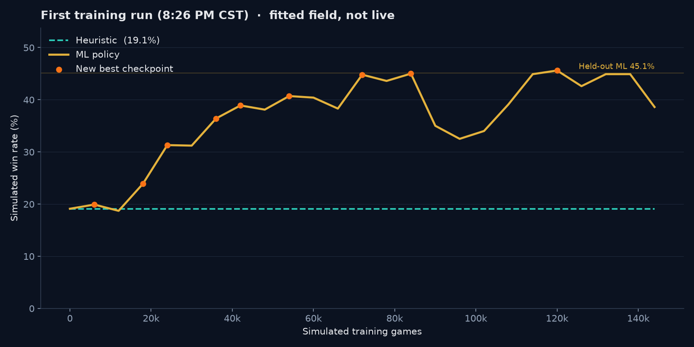
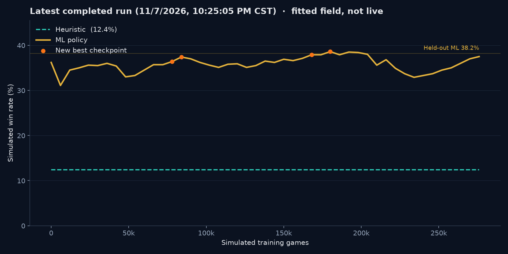
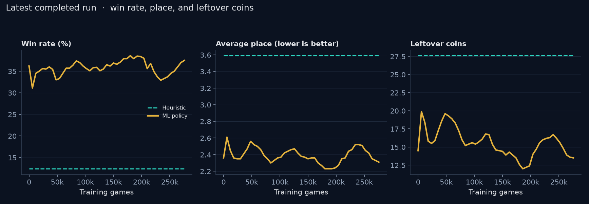
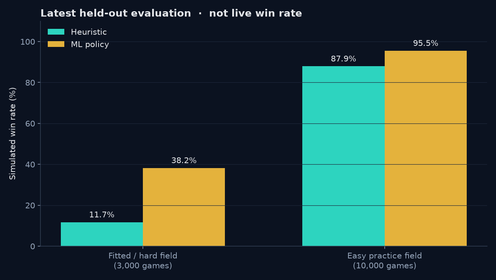

<h1 align="center">scrabble-bot-predictive</h1>

<p align="center">
  A casual-lobby <a href="https://scrabblebot.spacetimedb.com/">ScrabbleBot</a> that predicts which letters are worth buying — then spends its coins on words instead of leaving them unused.
</p>

<p align="center">
  
  
  
</p>

`scrabble-bot-predictive` joins public Vickrey matches on [SpacetimeDB](https://spacetimedb.com/). It never registers for a tournament. It starts with 100 coins, bids for letters against five other bots, then cashes those letters into words. Unspent coins are worth nothing at the end.

Each turn, one tile goes up for auction. The highest bidder wins the letter but pays the **second-highest bid**. Tiles nobody wants are gone for good. Word payouts grow with length: 2–3 letters pay 1×, 4 pay 1.5×, 5 pay 2×, 6 pay 2.5×, and 7+ pay 3×.

## Program structure



The LLM coach reads simulator traces and writes a packet. It never sits on the live bid path, so a slow model call cannot miss an auction.

## How a live decision is made



## Training trend

These charts are from the simulator log. They are **not** live win rate. The first run is the clearest growth story: the ML policy started tied with the heuristic at 19.1% and climbed to a **45.6%** peak, with a held-out result of **45.1%**.

<p align="center">
  
</p>

<p align="center">
  
</p>

Later runs used a harder heuristic baseline (the strategy rails had changed, so the heuristic won about 12% instead of 19%). The latest completed fine-tune reached a held-out **38.2%** on the fitted field, versus **11.7%** for the heuristic.

<p align="center">
  
</p>

<p align="center">
  
</p>

<p align="center">
  
</p>

| Field | Games | Heuristic wins | ML wins | ML average place | ML leftover coins |
| --- | ---: | ---: | ---: | ---: | ---: |
| Fitted / hard | 3,000 | 11.7% | **38.2%** | 2.25 | 12.8 |
| Easy practice | 10,000 | 87.9% | **95.5%** | 1.05 | 8.7 |

The easy field is a much softer opponent mix. Use the hard column for the honest simulator read.

## Run

```bash
npm install
BOT_NAME=scrabble-bot-predictive BOT_TOKEN=<token> npm start
```

The token is saved to `.token-scrabble-bot-predictive` (gitignored). Later runs only need:

```bash
BOT_NAME=scrabble-bot-predictive npm start
```

Do not set `TOURNAMENT_ID`. The bot will refuse to register for a tournament.

## Train

```bash
npm run ml-train
```

Useful extras:

```bash
npm test          # strategy, simulator, and ML tests
npm run sim       # run the match simulator
npm run coach     # write an LLM coach packet from traces
npm run ml-eval   # evaluate a saved policy
```

## Project layout

```text
src/            Live client, strategy, Quackle-inspired eval, ML policy, online learning
src/sim/        High-speed match simulator, trainer, coach, and fitted opponents
sim/            Saved policies, training log, and coach packets
reviews/        Chess-style notes from earlier live matches
spacetimedb/    Official word list used for search and scoring
docs/images/    Training charts, comparisons, and the animated growth GIF
```

## Safety

Never commit `.token-scrabble-bot-predictive`, `BOT_TOKEN`, or `BOT_NONCE`. Those stay on the machine that runs the bot.

Built for [HackUTD](https://hackutd.co/) against the public [ScrabbleBot](https://github.com/clockworklabs/scrabblebot) module.
